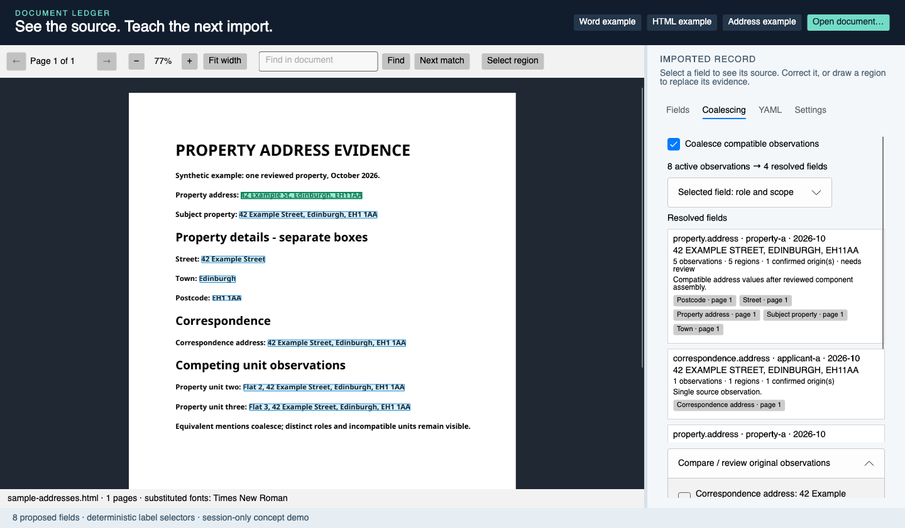

# Document ledger

Structured extraction from unstructured documents using live semantic templates.

A template defines the fields, types, cardinality and relationships we want to recover. Reviewed source evidence supplies reusable extraction patterns. Semantic fields can have several variants across document types; applicability should be inferred from document and local context.

The extraction core must also align synonymous fields, assemble fragmented values and coalesce equivalent observations into canonical fields with retained evidence. Address is the reference case: preserve distinct semantic roles, entities, units and periods. The independent [coalescing core](src/Mostlylucid.DocumentLedger.Core/AddressCoalescer.cs) implements a conservative address baseline, with [explicit scope guards and acceptance cases](docs/semantic-coalescing.md).

This repository contains the research notes and the first concrete example: a native Avalonia workbench with Morph Word/PDF/HTML rendering, linked evidence, manual teaching, local LLM suggestions and editable YAML. Generalised field variants and embedding/decision-model inference are the research direction; the running example currently replays simple label anchors.


## Run the example

Requires .NET 10 and a desktop session.

```sh
git clone https://github.com/scottgal/document-ledger.git
cd document-ledger/subprojects/morph-avalonia
dotnet run --project demo/Morph.Avalonia.Demo
```

See the [component README](subprojects/morph-avalonia/README.md) for model settings, UI scripts, rendering details and the Avalonia 12 UI-testing compatibility patch.

## Address coalescing example

Choose **Address example**, then **Coalescing**. Eight source observations become four resolved fields: five compatible property mentions/components, a separate correspondence role, and two conflicting flats. Disable automatic coalescing to expose all eight. Reviewed merge, keep-separate, rejection and undo retain original observations and resolution history. Each source link opens its recorded PDF region.



```sh
# From the repository root:
dotnet run --project verification/Mostlylucid.DocumentLedger.Core.Verification
```

The parser is a conservative UK-style example. Entity/period assertions and component groups require explicit context; this does not infer document families or geocode addresses. Snapshot JSON persists the address ledger; cached source PDFs remain separate local files.

## Read the code

- [Address observations and resolution records](src/Mostlylucid.DocumentLedger.Core/CoalescingModels.cs)
- [Deterministic scoped resolver](src/Mostlylucid.DocumentLedger.Core/AddressCoalescer.cs)
- [Ledger and initial neighbourhood records](subprojects/morph-avalonia/demo/Morph.Avalonia.Demo/DemoLedger.cs)
- [Evidence capture and anchor replay](subprojects/morph-avalonia/demo/Morph.Avalonia.Demo/MainWindow.axaml.cs)
- [Local LLM proposal adapter](subprojects/morph-avalonia/demo/Morph.Avalonia.Demo/LocalTemplateStarter.cs)
- [Document rendering and geometry](subprojects/morph-avalonia/src/Mostlylucid.Morph.Documents/DocumentSession.cs)
- [Native Avalonia viewer](subprojects/morph-avalonia/src/Mostlylucid.Morph.Avalonia/MorphDocumentViewer.axaml.cs)

## Research

- [Research and references](docs/research.md)
- [Architecture specification](docs/specification.md)
- [Core semantic coalescing contract](docs/semantic-coalescing.md)
- [Initial prototype and bootstrap](docs/initial-centroid.md)
- [Implementation plan](docs/plan.md)
- [Recorded verification](docs/verification.md)

The screenshots use synthetic documents. Downloaded evaluation documents, generated artifacts and external project source are excluded from the repository.

## License

MIT for this project. Bundled Noto Sans fonts retain their [OFL license](subprojects/morph-avalonia/src/Mostlylucid.Morph.Documents/Fonts/OFL.txt). Dependencies retain their own licenses and publisher requirements.
