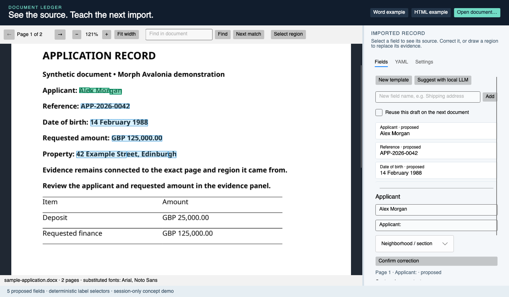

# Document ledger

Structured extraction from unstructured documents using live semantic templates.

A template defines the fields, types, cardinality and relationships we want to recover. Reviewed source evidence supplies reusable extraction patterns. Semantic fields can have several variants across document types; applicability should be inferred from document and local context.

This repository contains the research notes and the first concrete example: a native Avalonia workbench with Morph Word/PDF/HTML rendering, linked evidence, manual teaching, local LLM suggestions and editable YAML. Generalised field variants and embedding/decision-model inference are the research direction; the running example currently replays simple label anchors.



## Run the example

Requires .NET 10 and a desktop session.

```sh
git clone https://github.com/scottgal/document-ledger.git
cd document-ledger/subprojects/morph-avalonia
dotnet run --project demo/Morph.Avalonia.Demo
```

See the [component README](subprojects/morph-avalonia/README.md) for model settings, UI scripts, rendering details and the Avalonia 12 UI-testing compatibility patch.

## Read the code

- [Ledger and initial neighbourhood records](subprojects/morph-avalonia/demo/Morph.Avalonia.Demo/DemoLedger.cs)
- [Evidence capture and anchor replay](subprojects/morph-avalonia/demo/Morph.Avalonia.Demo/MainWindow.axaml.cs)
- [Local LLM proposal adapter](subprojects/morph-avalonia/demo/Morph.Avalonia.Demo/LocalTemplateStarter.cs)
- [Document rendering and geometry](subprojects/morph-avalonia/src/Mostlylucid.Morph.Documents/DocumentSession.cs)
- [Native Avalonia viewer](subprojects/morph-avalonia/src/Mostlylucid.Morph.Avalonia/MorphDocumentViewer.axaml.cs)

## Research

- [Research and references](docs/research.md)
- [Architecture specification](docs/specification.md)
- [Initial prototype and bootstrap](docs/initial-centroid.md)
- [Implementation plan](docs/plan.md)
- [Recorded verification](docs/verification.md)

The screenshots use synthetic documents. Downloaded evaluation documents, generated artifacts and external project source are excluded from the repository.

## License

MIT for this project. Bundled Noto Sans fonts retain their [OFL license](subprojects/morph-avalonia/src/Mostlylucid.Morph.Documents/Fonts/OFL.txt). Dependencies retain their own licenses and publisher requirements.
