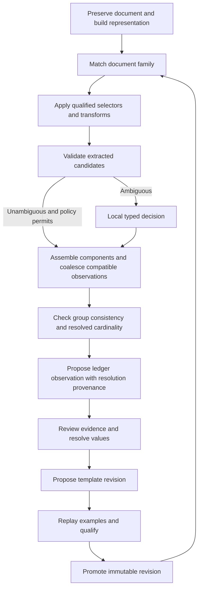

# Document ledger specification

Status: concept demo first; broader architecture below is a research direction. Build a desktop workbench where a ledger defines the information to collect and a template records how to find it. Users review several documents together, retain every observation with evidence, and teach rules that make future imports more deterministic.

## Immediate demonstration scope

The primary screen has **the document on the left and the imported record on the right**. Select a field to highlight its source; correct its value or select a new source region; confirm the correction. A secondary YAML tab exposes the mixed ledger/template and lets users edit its values, settings and selectors. Use synthetic forms and a few variants. No production import infrastructure is required to demonstrate the idea.

The current Morph demo implements digital Word/PDF/HTML display, empty-template creation, manual fields, local generative LLM suggestions, deterministic label replay, linked evidence, correction feedback and editable session YAML. It seeds label/neighborhood/position features immediately; embedding recipes are explicitly pending. It does not yet induce shared rules, run decision/embedding models, invoke StyloExtract, fetch URLs, or persist workspaces. See [initial centroid and bootstrap](initial-centroid.md). Those become focused experiments after the interaction is convincing.

## The mixed ledger/template as an evolving centroid

The durable object combines what an import has taught us with how future documents should be interpreted. Its ledger side retains values, observations, provenance and review history. Its template side retains neighborhoods, selectors, applicability and learned regularities. Keep these in one inspectable artifact with distinct sections, so personal field values do not accidentally become form constants.

A centroid exists at several scopes: form/document family, content area, field neighborhood. For a property address, learn the section heading, nearby label aliases, relative position, multiline shape, alignment, table/DOM relations and competing address roles. The postal address's wording can change completely while this neighborhood stays useful. Borrower, property and correspondence addresses need separate roles even when they share a postcode pattern.

Represent each family with several prototypes when needed: a centroid and dispersion for a coherent variant, plus real exemplars/medoids, rather than averaging incompatible layouts into one center. Maintain separate text, image and structural features, or a documented joint encoding; identify every embedding space/version. A normalized weighted vector mean is a retrieval summary, not an executable extraction rule. Never compare vectors from different versions or dimensions.

Learn commonality between local templates: align the semantic field roles, find recurring anchors and relations across independently reviewed examples, then propose a shared rule with explicit applicability. Keep issuer/form-specific overrides and negative examples. Preview the proposed rule against nearby families so a shared “Address” label cannot silently unify property and correspondence addresses. Repeated imports of identical bytes contribute once.

```yaml
artifact_version: 1
family: application-form
revision: 3
state: draft
schema: application-v1
neighborhoods:
  property_address:
    role: property.address
    section: [Property details, Security property]
    anchors: [Property address, Address of property]
    relations:
      value: below-or-right-of-anchor
      stop_before: [Purchase price, Property type]
      exclude_sections: [Correspondence, Applicant details]
    validators: [postal-address-shape]
    variants: [boxed-form, two-column-form]
    reviewed_examples: [sha256-example-a, sha256-example-b]
    rejected_examples: [sha256-correspondence-example]
    embedding_profile: gemma2-text-image-768-clustering-v1
ledger:
  observations:
    - field: property.address
      value: 42 Example Street, Edinburgh
      source: sha256-example-a
      page: 0
      region: {x: 0.18, y: 0.35, width: 0.42, height: 0.06}
      status: confirmed
```

This illustrative future artifact is richer than the demo's deliberately small YAML schema. Large vectors and private source assets can live in referenced sidecars; the human-editable artifact keeps settings, provenance and revision diffs readable.

## Semantic deduplication and coalescing

This is a required core extraction stage. Align locally discovered fields to canonical roles, assemble compatible fragments into typed values, deduplicate equivalent observations and resolve a canonical field value with retained provenance. Address is the reference case. See the [core contract and acceptance cases](semantic-coalescing.md).

Scope observation coalescence by supported entity association, semantic role and effective period. Property and correspondence fields remain separate relationships even when their address values are identical. Missing components remain unknown; incompatible units, roles or dates remain separate or conflicting. Preserve each source observation and component region, record reversible merge decisions and prevent duplicated source lineage from inflating support.

Use deterministic component comparisons as a baseline, optional embeddings for retrieval and bounded decisions for ambiguity. Validate both candidate values and proposed groups. Apply resolved-field cardinality after compatible observations have been coalesced. The independent address core and demo now implement this deterministic baseline, reviewed component assembly, reversible decisions and source provenance. Embedding/decision-provider integration and inferred scope remain future work.

## User workflow

1. Start from a blank schema, a supplied template pack, or an existing ledger. Define entities, fields, types, required values, identity keys, and validation rules.
2. Add PDF and Word documents to a case. Preserve originals and render pages immediately; process extraction in the background.
3. Match document families and apply qualified extraction rules. Show proposals alongside the relevant page.
4. Select text or a region, connect it to a ledger field, confirm or correct the value, and resolve conflicting observations.
5. Choose whether a correction applies only to this import, this document family, or the reusable schema vocabulary.
6. Preview a proposed template revision across the example set. Promote it after qualification.
7. Export reviewed records with validation status and evidence references. Later imports reuse the promoted revision.

Example: an application, a statement, and an identification document supply different fields for one person. A reviewed date of birth can resolve identity ambiguity; a statement balance has an effective date and cannot overwrite a balance from another period. The next statement uses learned headings, column signatures, and date/currency parsing before asking the model anything.

## Ledger and evidence

The ledger retains observations independently from the current canonical value. Missing, unreadable, explicitly blank, contradictory, and rejected are distinct states. Unmapped text and table structure remain available for later mapping, subject to workspace retention settings.

| Record | Required content |
| --- | --- |
| Workspace | Scope, settings, schema versions, retention and export destinations. |
| Document | Original hash, source name and format, case, import time, derived artifact identities. |
| Document representation | Pages, blocks, text spans, tables, cells, reading order, structural paths where available, coordinate transforms. |
| Entity | Stable ID, type, identity keys, reviewed links and merges. |
| Observation | Entity candidate, field, raw and typed value, unit/currency, effective date, status, evidence IDs, producer version. |
| Evidence | Original document ID/hash, derived representation ID, page index, normalized region(s), quote/character span, optional DOCX part/path. |
| Resolution | Accepted observation(s), derived value if applicable, rationale, actor, time and superseded resolution. |
| Template revision | Schema compatibility, family signature, selectors, transforms, guards, examples and qualification results. |
| Review event | Prior/new value, decision, scope and actor; append-only correction history. |
| Import run | Input hashes and schema/template/parser/OCR/model versions, outputs, validation and replay manifest. |

Use decimal values for money and explicit currencies. Use typed dates with an explicit locale policy. Entity links require sufficient identity evidence; similarity of names alone stays reviewable. Resolve disagreement by configured field policy and effective date, with human review where the policy cannot decide. Never let document arrival order implicitly choose truth.

SQLite stores local state and searchable text; content-addressed files store original documents and derived assets. A workspace archive contains its schema, template revisions, ledger, evidence and manifest. A distributable template pack excludes private example documents and entity values by default. Pack imports validate schema and selector compatibility.

## Extraction and learning



Templates store field types, label aliases, section anchors, repeated headers, row/column signatures, structural paths, normalized regions, expected cardinality, parsing rules, cross-field constraints, exclusions, positive/negative examples, and known variants. Prefer stable labels and structural relationships; absolute regions need accompanying guards. Document family and entity identity are separate matches.

Learning means updating inspectable artifacts and empirical scores. Model fine-tuning is a later experiment. A reviewed correction creates a proposal, not an immediate global rule. Scope examples by workspace, schema version, family and issuer when relevant. Persist rejections and distinguish independent examples from repeat imports of the same hash.

Revision states are Draft, Candidate, Qualified, Promoted, Retired. Qualification uses examples distinct from induction examples where available, measures field precision and coverage separately, and includes negative documents. One example can yield a useful draft; it cannot establish broad generalization. A failed output guard blocks automatic acceptance even when a family fingerprint matches. Drift produces a review item and candidate revision; the promoted version remains reproducible.

## Local decision contract

The deterministic layer supplies a bounded candidate set and provenance. The model may rank document families, choose a field candidate, classify a relationship, or assess whether evidence supports a proposed mapping. It returns a typed answer, including abstention, with recorded scores. It does not invent field values.

Default evaluation starts with Tev1 0.8B; Tev1 4B and Nimble are interchangeable optional providers. Runtime configuration is explicit and checked before use. Model failure, context overflow, missing answers or malformed choices produce review items. The workbench remains usable when no model server is running. No hosted inference is required.

Acceptance combines extraction checks, empirical template qualification and review policy. Model scores alone cannot authorize canonical updates. Bound document snippets and question count; record exactly which evidence was supplied and whether anything was excluded. Cache identity includes document representation, candidates, question version, model digest and runtime identity.

## Avalonia client

The main concept screen contains a native page viewer on the left and imported fields on the right. A secondary YAML view edits the mixed artifact. A document queue and richer ledger grid can follow if the concept merits them. Selecting a ledger observation navigates to its evidence. Selecting page text or drawing a region proposes a field mapping. The details panel shows raw value, typed value, competing evidence, rule provenance, history and review actions.

Provide page navigation, zoom, search, evidence overlays, keyboard operation, correction undo/redo and progress/cancellation. Changes that affect canonical values or template scope remain visible in a review diff. A template editor previews selected revisions against multiple documents and shows regressions before promotion.

The reusable viewer subproject owns rendering, page coordinates and selection events. It has no ledger schema or model dependency. The host supplies highlights with stable IDs and consumes selection events. Coordinates use page-local normalized top-left space and zero-based page indexes; user-facing page numbers are one-based.

## Possible later delivery

A later ledger MVP could support digital PDF/DOCX, generic schemas, manual review, deterministic templates, local candidate decisions and JSON/CSV export. Scanned PDFs then add OCR with explicit OCR provenance. Repeating tables follow with continuation headers and page splits. Spreadsheet ingestion, report generation, external destination connectors and collaboration are later extensions.

Original files remain immutable. Word preview uses a generated PDF and records the font/render configuration. Exact extraction-to-DOCX structure alignment is separately qualified. Search and geometric evidence selection can operate on the generated PDF immediately.
